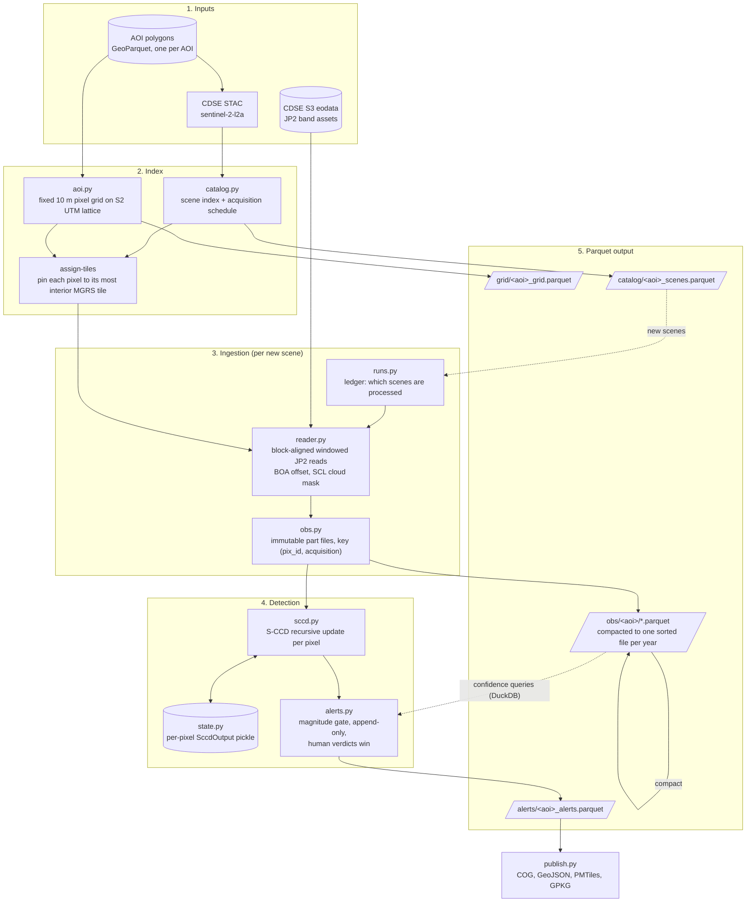
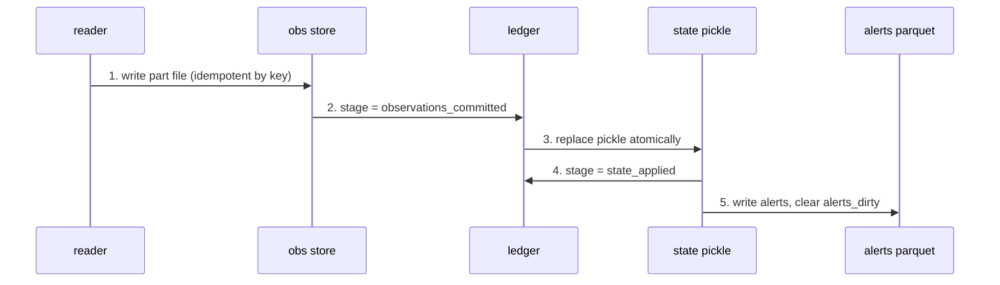

# Architecture: ingestion to Parquet output

How a Sentinel-2 scene on CDSE becomes a row in the alerts Parquet. Module names
are in `src/effektovervaking_forests/`; see [operational.md](operational.md) for
the reasoning behind each step.

## Commit order within one scene

Each write is atomic (`store.write_parquet` writes a temp file, then renames), and
the order means a crash always leaves work to redo, never work silently lost.

A scene stuck at `observations_committed` is replayed from disk on the next run,
not re-read from CDSE. An observation is never applied to the recursive model
twice.

## One-off gates before the cycle runs

`parity check` (CDSE equals Earth Engine on raw DN) must pass before
`sccd bootstrap` fits the initial per-pixel state. After that, `forestmon run
<aoi>` is the only command a timer needs.
