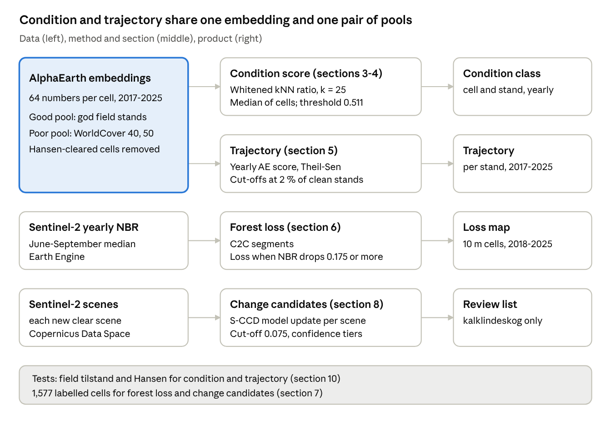

::: {.callout-note appearance="simple"}
This is the methods appendix of the report "Remote sensed monitoring of olivinskog and kalklindeskog,
2017-2025". It is a living document: it is updated together with the analysis, and the date above shows
when it last changed. Section, table and figure numbers are kept stable so that references from the
report remain valid.
:::

Companion to the report of the same name. The report cites this document as "Methods section n".

# 1. Purpose and overview {#section-1 .unnumbered}

The method gives four products for the 737 mapped olivinskog and kalklindeskog stands. They are a condition score per 10 m cell and per stand for each year 2017-2025, a condition trajectory per stand, a forest-loss map for 2018-2025, and a near-real-time list of change candidates for both forest types. This document describes each product as it was run for the report. The report gives the results; this document describes the methods, the parameters and the evaluation.

{#fig-pipeline width=100%}

The two upper rows use the same embedding and the same reference pools; the two lower rows use Sentinel-2 directly and do not use the field-assigned condition.

The four products use different data and answer different questions:

| Product | Question | Main data | Unit | Section |
| --- | --- | --- | --- | --- |
| Condition score (AE score) | Is this ground like good forest of its type, or like transformed land? | AlphaEarth annual embeddings, field-assigned condition, ESA WorldCover | 10 m cell and stand, each year | 3, 4 |
| Trajectory | Is the stand moving towards good or towards transformed land? | yearly AE score, nature type scope | stand, 2017-2025 | 5 |
| Forest loss (C2C) | Where and which year was tree cover removed? | Sentinel-2 annual NBR | 10 m cell, 2018-2025 | 6 |
| Change candidates (S-CCD) | Did a new Sentinel-2 image show an abrupt change? | Sentinel-2 scenes, as they arrive | 10 m cell, each scene | 8 |

The trajectory is built from the condition score itself: it is the trend of the stand's yearly AE score at the nature type scope. The AE score provides a status for a single year. The trajectory provides information on the direction the stand moved over nine years (2017-2025).

The forest-loss map and the change candidates measure canopy loss and abrupt spectral changes, respectively. They do not use the field-assigned condition. They are tested against 1,577 cells that we manually labelled through visual inspection of high resolution satellite imagery (section 7).

All code is in the project repository. The condition steps are in the folder src/effektovervaking\_forests/`condition/`, C2C is in `scripts/`, and the S-CCD service is in `src/effektovervaking_forests/` (section 13).

# 2. Data sources {#section-2 .unnumbered}

## 2.1 Mapped stands and field surveys {#section-2-1 .unnumbered}

The data set has 737 mapped polygons from six layers: three field surveys for each of the two forest types. The file is `data/condition/data/skog_kartlegginger.gpkg in the repository`.

| Survey | Kalklindeskog | Olivinskog | Field-assigned condition recorded |
| --- | --: | --: | --- |
| Miljødirektoratet nature-type mapping (MI) | 268 | 93 | yes |
| Nature in Norway (NiN) mapping, 1:5000 | 65 | 16 | yes |
| DN-håndbok 13 (HB13) | 256 | 39 | no |
| Total | 589 | 148 |  |

A survey visits a stand once. It records one field-assigned condition (tilstand in Norwegian) for the stand on that date. Field-assigned condition is recorded for 440 stands: good (god) 263, moderate (moderat) 141, and poor (dårlig or svært redusert) 36, of which 20 dårlig and 16 svært redusert. The labelled stands were surveyed from 2015 to 2025.

**Overlaps.** Polygons from different surveys often cover the same ground. The six layers overlap on 24 % of their combined area. Each polygon keeps its own score, but every area in the report uses the union of the polygons, so no ground counts twice. The union is 384 ha of kalklindeskog and 1,310 ha of olivinskog. The approach used to estimate condition functions at the unit of a 10 m cell, and each cell has a list of all the polygons that cover it (`src/effektovervaking_forests/condition/membership.py`). A cell that two layers label differently (for example good in one survey and moderate in another, usually from surveys in different years or with different survey approaches) is a conflict cell. Conflict cells enter no reference pool.

## 2.2 AlphaEarth Foundations annual embeddings {#section-2-2 .unnumbered}

AlphaEarth Foundations [@brown2025] gives one embedding for each 10 × 10 m cell for each year. The embedding is 64 numbers that summarise multiple satellite signals of that cell over the year. We use the years 2017-2025.

We read the embeddings from the public Source Cooperative copy (`data.source.coop/tge-labs/aef`).

## 2.3 Sentinel-2 {#section-2-3 .unnumbered}

Two products use Sentinel-2 surface reflectance.

- **C2C** (section 6) uses the harmonised Sentinel-2 surface reflectance collection in Earth Engine (`COPERNICUS/S2_SR_HARMONIZED`). A cell is masked when its s2cloudless cloud probability (COPERNICUS/S2\_CLOUD\_PROBABILITY) is 40 % or more. It is also masked when the scene classification (SCL) marks it as cloud shadow, cloud, cirrus or snow (classes 3 and 8-11).
- **S-CCD** (section 8) reads new Sentinel-2 Level-2A scenes from the Earth Observation Processing Framework (EOPF), bands B02, B03, B04, B08, B11 and B12. Cells are masked with the scene classification only (classes 3 and 8-11).

## 2.4 Other maps {#section-2-4 .unnumbered}

| Data set | Version | Use |
| --- | --- | --- |
| Hansen Global Forest Change [@hansen2013] | v1.13 (`UMD/hansen/global_forest_change_2025_v1_13`) | Removes cleared cells from the good pool (section 3.4) and sets the trajectory cut-offs on unchanged ground (section 5.3). Check on trajectory recall for cleared cells (section 10.3) and on forest loss (section 6.3). |
| ESA WorldCover [@zanaga2022] | v200, 2021 | Cropland (class 40) and built-up (class 50) form the poor pool (section 3.5). |
| RADD-Europe [@vanderwoude2026] and OPERA DIST-ALERT [@opera2024] | alert layers | Comparison layers for forest loss (section 6.3). |

## 2.5 Imagery for labelling {#section-2-5 .unnumbered}

The labelled cells (section 7) were judged from three sources together: the Sentinel-2 time series of the cell, Google Earth high-resolution imagery, and the ESRI World Imagery Wayback archive. Wayback, similar to Google Earth, gives dated high-resolution images of the same place, so a reviewer can see when trees were removed. Aerial photos in report figures come from Norge i bilder (Kartverket).

# 3. Forest ecological condition score (AE score) {#section-3 .unnumbered}

The AE score compares each cell with two sets of reference cells: cells of good forest of the same type (the good pool) and cells of transformed land (the poor pool). A score near 1 means the cell is like the good pool. A score near 0 means it is like the poor pool. Five parts are specific to this project: the cell as unit, the distance metric, the two pools, the spatial exclusion and the stand score.

## 3.1 The unit is the cell {#section-3-1 .unnumbered}

A stand is not in one condition. A stand with a clear-cut in one part and intact forest in another part has a mean that describes neither part. So the method scores each 10 m cell in each year. The stand score is the median of its cell scores (section 3.7). The quartiles and the share of cells below the threshold describe the spread within the stand.

## 3.2 The distance metric: shrunk whitening {#section-3-2 .unnumbered}

Each 10 m cell is described by 64 numbers from AlphaEarth. Some of these numbers may mainly reflect terrain and image conditions rather than forest condition. A plain cosine distance gives each of the 64 numbers equal weight. But the numbers overlap: one underlying factor, such as terrain, can be spread over several of the 64 dimensions and so count several times over. Whitening removes this overlap so that each independent pattern counts about once, much like running a PCA and standardising the components; on our stands it raised good-vs-poor AUC from 0.65 to 0.71. So all comparisons are made after whitening. For each forest type separately, every cell goes through three steps:

1. Put every cell on the same footing, much like turning species counts into relative abundances. This is done by dividing each of the cell's 64 numbers by the cell's overall size (the square root of the sum of the squared numbers). Each number then stands for its share of the cell's whole profile, so cells are compared on which of the 64 numbers are high and which are low.
2. Subtract the average cell of that forest type, so what is left is how the cell differs from a typical one.
3. Divide each pattern of variation by how much it normally varies across the forest type, so terrain and season no longer dominate. A small safety margin (shrinkage, set to 0.2) stops rare, noisy patterns from being blown up.

Two cells are then compared by how similar their whitened patterns are (cosine distance): 0 when they match, and larger the more they differ. The exact formula is in the Appendix.

The average μ and the spread Σ come from cells in stands with no condition label, so the field labels do not influence the comparison. The average and spread are fitted once per forest type, on up to 60,000 unlabelled cells pooled over 2017-2025. The shrinkage λ = 0.2 blends the measured spread with an even spread [@ledoit2004]. With no shrinkage (λ = 0), rare and noisy patterns get the most weight and scores become unstable; with λ = 1 nothing is rescaled. The fitted values are in data/`condition/outputs/data/whitener.json`.

The cosine distance between two whitened cells is 1 minus the cosine of the angle between them.

## 3.3 The score of a cell {#section-3-3 .unnumbered}

For a cell, let m\_good be the mean cosine distance to its k = 25 nearest cells in the good pool, and m\_poor the mean cosine distance to its 25 nearest cells in the poor pool. The AE score is

$$
\text{AE} = \frac{m_{\text{poor}}}{m_{\text{good}} + m_{\text{poor}}}
$$

With k = 25 the score depends less on which single reference stand is nearest. k was tested from 1 to 50 (stand AUC 0.68-0.72); 25 was chosen because it narrows the AE score interval (uncertainty). Caps of 20-200 cells per stand changed AUC by less than 0.01. The shrinkage was tested from 0 to 0.9. Stand AUC barely changed (0.78-0.80). Stronger shrinkage made the score worse at telling good from poor stands in the same area (AUC 0.83 at 0 to 0.75 at 0.9). It also made more poor stands look good (4 to 8 of 35). λ = 0 and 0.2 performed about the same, and 0.2 was kept.

## 3.4 The good pool {#section-3-4 .unnumbered}

The good pool is cells of stands that a field survey called good, of the same forest type as the scored stand. Four rules apply.

1. **Survey year only.** Field-assigned condition describes the stand on the survey date. So a reference stand gives only its cells from its survey year. A stand surveyed before 2017 (no embedding) cannot be a reference. Of the 263 good stands, 244 can be references: 13 were surveyed outside 2017-2025, and 6 have too few cells that all surveys call good.
2. **Cleared cells removed.** Cells that Hansen shows as cleared in or before the survey year of their stand are removed. In this run that removed 1,072 cells from 35 stands.
3. **At most 60 cells per reference stand,** so a large stand does not outweigh many small ones.
4. **Two scopes.**
   - *Local scope*: good stands near the scored stand. For olivinskog, every good stand within 20 km, and at least the nearest 8. For kalklindeskog, the nearest 32 good stands. A reference stand more than 50 km away is never local. The two forest types have different rules because they have different numbers of good stands nearby. A kalklindeskog stand has a median of 54 possible reference stands within 3-20 km. An olivinskog stand has 6.
   - *Nature type scope*: all good stands of the forest type in Norway. The report uses it for all trajectories, and for the 44 stands with no local scope class in 2025 (12 kalklindeskog, 32 olivinskog). Of these 44 stands, 33 have no possible reference stand 3-50 km away. The other 11 have only one, so no interval can be calculated (section 3.7).

## 3.5 The poor pool {#section-3-5 .unnumbered}

The poor pool is cells of transformed land: cropland (class 40) and built-up land (class 50) in ESA WorldCover 2021. The cells are taken from a ring 3-8 km around each stand. The inner edge keeps the stand's own edge out of the pool. The outer edge keeps the reference in the same region. The rings of all stands of one forest type are pooled, to at most 2,000 cells per forest type and year, drawn at random with a fixed seed. A cell scored for a given year is compared only with poor-pool cells from that same year.

Grassland (class 30) and bare ground (class 60) are not used. In Norway, grassland includes natural mountain vegetation and semi-natural pasture, and bare ground is mostly rock and scree.

The poor pool is transformed land, not the stands that a field survey called poor. The field-poor stands are used only to fit and test the threshold used to separate the good, indistinguishable and poor condition stands (sections 4 and 10).

## 3.6 Spatial exclusion {#section-3-6 .unnumbered}

The surveys assess condition of many stands that are in close proximity producing clustering in space. If a reference stand is a few hundred metres from the scored stand, and may also experience the same changes as the scored stand and can therefore inflate the condition score. Moreover, a good stand whose centre is within 3 km of the scored stand cannot be a reference for it since it is not statistically independent and can inflate evaluation metrics if not controlled for. The 3 km rule applies to every published score. It was chosen by comparing 0, 1, 2, 3 and 5 km and whole-block exclusion, and matches the inner edge of the poor-pool ring, so both pools use one rule. Stands that touch or overlap the scored stand are also excluded.

For the threshold and for the intervals, the method also uses spatial blocks. A block is a group of stands made by selecting stands with stand centres at 5 km; overlapping stands are merged into one block (`src/effektovervaking_forests/condition/blocks.py`). The 286 good and poor stands scored in their survey year (250 good, 36 poor) fall in 39 blocks.

## 3.7 The stand score and its interval {#section-3-7 .unnumbered}

The stand score is the median of the stand's cell scores in that year, for each scope. The median separates good from poor stands at AUC 0.84 (local scope).

The 95 % interval of the stand score shows how sensitive the score is to the selected reference cells in its pools. To find it, the scoring is repeated 2,000 times, each time with a slightly different set of references drawn at random (a bootstrap). Each draw picks whole good stands from the good pool and whole 500 m grid squares from the poor pool, never single cells: the 60 cells from one reference stand are close copies of each other and count as one piece of evidence, not sixty. In each draw, all cells of the scored stand are scored again against the same references, and the stand value is again the median over its cells. Drawing single cells, or a new set of references for each cell, would make the interval too narrow. For the 189 stand-years (21 stands) with more than 2,001 cells, the interval is computed on 2,001 cells spread evenly over the range of the stand's cell scores. This changes the interval by less than 0.0001. The median interval width is about 0.05 for the local scope and 0.04 for the nature type scope; 32 % of stand-years are indistinguishable at the local scope (27 % in 2025). The interval covers reference-pool sampling only, not embedding noise or label error.

Cell scores have no interval. All cells of a stand share one reference pool, so the pool error is a property of the stand, not of each cell.

# 4. Threshold and condition classes {#section-4 .unnumbered}

A threshold of about 0.51 separates good from poor condition, for cells and for stands, in both forest types. It is fitted on the stands that have a local score in their survey year: 238 good and 35 poor stands. Moderate stands are not used in the fit, because Youden's J needs two classes. Moderate stands are used later as a check: their scores should fall between good and poor (section 10). The threshold's own uncertainty (± about 0.015) is not carried into the class, so stands close to it may change class.

**The fit.** The threshold is the value that makes Youden's J largest [@youden1950]:

$$
J = \text{share of good stands above the threshold} + \text{share of poor stands below it} - 1
$$

At 0.511, 73.5 % of good stands are above and 82.9 % of poor stands are below, so J = 0.564 (S3\_PREFIX/condition/parquet`/threshold.json`).

**Fitted outside the stand's own block.** For each spatial block (section 3.6) the threshold is fitted again without the stands of that block, and the stands of the block are classified with that threshold. Every stand, with or without a field label, is classed with its own block's threshold: 0.511 in most blocks, 0.499 and 0.503 in two large blocks.

**Classes.** A stand is classed with its 95 % interval (section 3.7):

| Class | Rule |
| --- | --- |
| Good | the whole interval is above the threshold |
| Poor | the whole interval is below the threshold |
| Indistinguishable | the interval includes the threshold |

Moderate stands are expected to straddle the threshold. Across all their stand-years (local scope) they split 359 good, 403 indistinguishable and 462 poor.

A stand with no score in a year has no class for that year. The nature type scope has its own threshold, 0.512, fitted the same way on 250 good and 36 poor stands (J = 0.479).

# 5. Trajectories {#section-5 .unnumbered}

A trajectory tells which way a stand moved from 2017 to 2025: declining, improving, stable or fluctuating. It uses one number per stand per year, and the class cut-offs are set on stands where Hansen shows no forest loss, so that about 2 % of those stands fall in each of declining and improving.

## 5.1 The yearly value {#section-5-1 .unnumbered}

Each year, every stand gets one number: its AE score at the nature type scope (section 3), which is the median of its cell scores against all good stands of its forest type. A higher value means more like good forest; a lower value means more like transformed land. The nature type scope is used so that every stand has a value, including the 44 stands with no local score.

**Year-to-year noise.** Each year's score is compared with a poor pool from that year's images, so part of each change comes from the images. Around its own trend, a stand's yearly value varies by a median 0.13 (SD of residuals).

## 5.2 Common scale and trend {#section-5-2 .unnumbered}

The values of each forest type are put on a common scale (z-score) with the mean and standard deviation of all its stand-years. A slope of 0.1 per year then means the same in both forest types.

The trend is the Theil-Sen slope [@sen1968]: the median of the slopes between all pairs of years. One extreme year has little effect on it. A stand needs a value in at least 6 of the 9 years (2017-2025), otherwise it has no trajectory. In this run all 737 stands have all 9 years. The Mann-Kendall test [@mann1945; @kendall1975] is also calculated and stored (`mk_p`), but it does not set the class.

## 5.3 Classes {#section-5-3 .unnumbered}

| Class | Rule |
| --- | --- |
| Declining | slope below −0.100 z-units per year |
| Improving | slope above +0.159 z-units per year |
| Fluctuating | neither, and standard deviation of the yearly values (not of the residuals around the trend) 0.50 or more |
| Stable | neither, and standard deviation below 0.50 |
| No data | fewer than 6 years with a value |

The two slope cut-offs are the 2nd and 98th percentiles of the slopes of stands where Hansen shows no clearing in any year (data/`condition/outputs/data/trajectory_gate.json`). So, by construction, about 2 % of unchanged stands are called declining and about 2 % improving. Over 737 stands that is about 15 in each class by chance. A count near 15 is therefore no evidence of a general trend.

The improving cut-off is further from zero than the declining one because the AE score drifts upward over the whole area: the median stand slope is +0.04 z-units per year. Improving therefore means rising faster than unchanged stands drift. The cause of this area-wide rise is not known. It may be recovery or come from the yearly images and embedding inputs; it is treated as the baseline.

The cut-off between stable and fluctuating, 0.50, is set on the same unchanged stands: 18.6 % of them are above it.

The cut-offs act on the size of the slope, not on its p-value. With nine annual values the Mann-Kendall test is correct but weak.

The same rule runs per cell, with cell cut-offs of −0.083 and +0.184 z-units per year, and 0.55 between stable and fluctuating.

# 6. Forest loss: C2C and comparison layers {#section-6 .unnumbered}

The forest-loss map is made with C2C [Composite2Change, @hermosilla2015] on a yearly Sentinel-2 normalised burn ratio (NBR) for each 10 m cell. A cell is described as loss when its largest NBR drop is 0.175 or more. The code is `scripts/run_c2c_export.py` (Earth Engine) and `scripts/build_c2c_pixels.py`.

## 6.1 Yearly NBR composite {#section-6-1 .unnumbered}

NBR [@keybenson2006] falls when the canopy is opened or removed:

$$
\text{NBR} = \frac{\text{B8} - \text{B12}}{\text{B8} + \text{B12}}
$$

B8 is near infrared and B12 is short-wave infrared 2. For each year 2017-2025, the composite is the median NBR of all clear observations from 1 June to 30 September (cloud mask in section 2.3). Each composite is dated 1 July.

## 6.2 Segments and the loss rule {#section-6-2 .unnumbered}

C2C fits up to 4 straight segments to the nine yearly values of a cell (maximum error 0.05; gaps filled; only drops kept). Where the line breaks downwards, C2C reports a change with its date and its size (magnitude). For each cell we keep the change with the largest drop.

- **Loss rule.** A cell is described as loss when that drop is 0.175 NBR or more. Without a cut-off, C2C finds a drop in more than half of the cells that are confirmed stable, because a small drop is common. The cut-off was chosen by cross-validation against a subset of the labelled cells (`scripts/tune_on_labels.py`, `results/label_tuning_cv.csv`).
- **Loss year.** C2C dates a change to the first composite after it. The first possible loss year is therefore 2018 and the last is 2025.
- **The last years are undercounted.** A break needs composites after it to be confirmed as a segment. Loss in 2024 has one later composite and loss in 2025 has none, so C2C finds less of it than in earlier years. The report's Figure 5 shows this against Hansen.
- **Areas.** Each 10 m cell is 0.01 ha. A cell inside two overlapping polygons is counted once.

C2C also stores for each cell the segment length before the change, the rate of change, regrowth after the change and the number of drops found (`data/c2c_pixels.geojson`).

## 6.3 Comparison layers {#section-6-3 .unnumbered}

C2C is the main loss layer. Three other layers are used for comparison. Hansen also cleans the good pool and sets the trajectory cut-offs; OPERA DIST-ALERT adds 0.15 to the S-CCD confidence.

| Layer | Sensor and cell | Period | Use |
| --- | --- | --- | --- |
| Hansen Global Forest Change v1.13 [@hansen2013] | Landsat, 30 m | loss years 2018-2025 | Independent check of C2C areas and accuracy (report Table 4) |
| RADD-Europe [@vanderwoude2026] | Sentinel-1 radar | public alert collection only | Supporting layer |
| OPERA DIST-ALERT [@opera2024] | Harmonized Landsat Sentinel-2, 30 m | from 2023 | Supporting layer |

All layers record canopy loss of any cause. None of them separates felling from storm or dieback, or forestry from permanent conversion.

# 7. Labelled cells and accuracy assessment {#section-7 .unnumbered}

The loss detectors are tested against 1,577 cells that we manually labelled: 41 loss, 19 degradation and 1,517 no change. Two sets of labels were made at different times. Point labels, one cell at a time from a stratified sample, were used to choose the loss cut-offs. Area labels, 1,215 cells in 44 drawn polygons, were made later and used only as an independent test.

## 7.1 How a cell is labelled {#section-7-1 .unnumbered}

For a cell, the reviewer looks at the Sentinel-2 NBR time series, the breaks of six change detectors, the Hansen loss year, and Sentinel-2 image chips by year. The annotator also checks Google Earth and ESRI Wayback high-resolution images (section 2.5). The annotator then gives one of four labels:

| Label | Meaning |
| --- | --- |
| loss | the tree cover was removed |
| degradation | the canopy was opened or damaged, but trees remain |
| none | no change |
| unsure | the images do not decide; not used |

If a cell was labelled more than once, the last label counts; labels with the same timestamp keep their order in the file. All labels are in `data/c2c_labels.csv`.

## 7.2 Two label sets {#section-7-2 .unnumbered}

| Set | Mode | Cells | Job |
| --- | --- | --: | --- |
| Point labels | one cell at a time, from the stratified sample in `data/accuracy_sample.geojson` (`scripts/draw_sample.py`, `docs/SAMPLING_DESIGN.md`) | 362 | choose the loss cut-offs, by cross-validation (`scripts/tune_on_labels.py`) |
| Area labels | a polygon is drawn over an area of the same state, and all cells inside get its label | 1,215 | independent test, made after the cut-offs were fixed |

The 1,215 area cells come from 44 polygons, 2 of them loss.

The area labels were made after the cut-offs were chosen, so they are an independent test. The report's "independent validation" uses them only.

## 7.3 Accuracy measures {#section-7-3 .unnumbered}

A detector "calls loss" in a cell when it has a drop at or above its cut-off (C2C: 0.175 NBR). Loss is the positive class. Degradation and no change are both negative for the loss test.

$$
\text{recall} = \frac{TP}{TP + FN}, \qquad \text{precision} = \frac{TP}{TP + FP}, \qquad F_1 = \frac{2\,\text{precision}\cdot\text{recall}}{\text{precision} + \text{recall}}
$$

TP is a labelled loss cell that the detector calls loss, FN a labelled loss cell it misses, and FP a cell it calls loss that is not labelled loss. The false-alarm rate is the share of no-change cells that the detector calls loss. The 95 % intervals for recall and precision are Wilson score intervals [@wilson1927], which work for small counts such as 41 loss cells. Wilson intervals treat cells as independent, so for area labels they are too narrow.

These measures describe the labelled cells. They are not an estimate of map accuracy over the whole area, because the cells are not a probability sample of it. A new stratified sample, not used for tuning, would give area-weighted accuracy and loss area [@olofsson2014].

# 8. Near-real-time change candidates (S-CCD) {#section-8 .unnumbered}

An automatic service checks each new clear Sentinel-2 scene over the stands of both forest types and writes a list of change candidates for a person to review. It runs on the Earth Observation Processing Framework (EOPF). The code is the `forestmon` command in `src/effektovervaking_forests/`.

## 8.1 What runs {#section-8-1 .unnumbered}

1. **Grid.** Fixed 10 m cells on the native Sentinel-2 grid of each UTM zone: 38,327 cells cover the kalklindeskog stands and 130,539 the olivinskog stands (7 and 25 Sentinel-2 tiles).
2. **Catalogue.** The service lists new Sentinel-2 Level-2A scenes from the EOPF catalogue for the Sentinel-2 tiles that cover the stands.
3. **Reading.** For each new scene it reads only the image blocks that contain stand cells, bands B02, B03, B04, B08, B11 and B12, and masks cells with the scene classification (section 2.3).
4. **Model update.** Each cell has a stored time-series model. Stochastic continuous change detection [S-CCD, @ye2021] updates that model with each new clear observation and tests the observation against it. A break is confirmed after 6 consecutive observations that do not fit the model (change probability 0.90). Settings: `src/effektovervaking_forests/config.py and src/effektovervaking_forests``/sccd.py`.
5. **Candidates.** Each confirmed break becomes one candidate, written to `S3_PREFIX/sccd/operational/alerts/kalklindeskog_alerts.parquet` and olivinskog\_alerts.parquet.

## 8.2 Magnitude and the cut-off {#section-8-2 .unnumbered}

The magnitude of a break is the change in near infrared (B08) minus the change in short-wave infrared 2 (B12). The change in a band is the difference between the observations after the break and the model before it, as S-CCD reports it. The stored values are divided by 10,000 to give reflectance; for images from processing baseline 04.00 onwards (from 25 January 2022), the offset in each image's metadata (-1000) is applied first. The magnitude is then:

$$
\text{magnitude} = \Delta\text{B08} - \Delta\text{B12}
$$

The magnitude ties directly to tree cover loss. A healthy canopy reflects much near infrared and little short-wave infrared. When trees are felled, burned or blown down, near infrared falls and short-wave infrared rises, as bare soil, dead wood and dry litter are exposed. Both changes push the magnitude down, so tree cover loss shows as a negative magnitude; regrowth does the opposite and shows as a positive one. A loss break becomes a candidate when the drop is 0.075 or more, a cut-off chosen on the 15 loss point labels (section 7.2; recall 0.47, precision 0.13); with so few labels it is a first setting. The magnitude uses the same two bands as NBR (section 6.1) but is a plain difference, not a ratio, so it is not on the same scale as the C2C loss cut-off of 0.175 NBR (section 11).

## 8.3 Status of a candidate {#section-8-3 .unnumbered}

| Status | Meaning |
| --- | --- |
| new | loss break dated on or after the monitoring start, 1 January 2026 |
| historical | loss break dated before the monitoring start |
| below\_gate | break below the cut-off, or a gain; kept but not shown |
| confirmed, verified, rejected | Set after a manual check of the candidate. A later run of the service never changes it. |

## 8.4 Confidence tier {#section-8-4 .unnumbered}

Each candidate gets a score from 0 to 1 and a tier from it. The score is not a probability.

$$
s = 0.5\,\min\!\left(\frac{n_{\text{confirm}}}{12}, 1\right) + 0.5\,\operatorname{clip}\!\left(\frac{|m|/0.075 - 1}{3 - 1},\, 0,\, 1\right)
$$

- n\_confirm is the number of clear observations after the break. clip(y, 0, 1) keeps y between 0 and 1. 12 is about one growing season of clear observations.
- The second term rises with how far the magnitude m is above the cut-off, up to three times the cut-off.
- An OPERA DIST-ALERT alert within 30 m and 90 days adds 0.15.
- A break dated November to February, or after a gap of more than 60 days without clear observations, is capped at 0.30. At 58-61° N there are almost no clear optical images in that period.

The score is capped at 1. The weights (0.5/0.5, +0.15, the 0.30 cap) are set by hand, not fitted to labels.

Tiers: low below 0.34, medium 0.34 to below 0.67, high 0.67 or more (`src/effektovervaking_forests/confidence.py`).

## 8.5 The first run {#section-8-5 .unnumbered}

For kalklindeskog, the first run, on 20 August 2026, flagged 192 new loss candidates, and later runs brought the total to 199 by 29 October 2026. For olivinskog, there are 2,694 new candidates, most of them low confidence and from the first run. None has been checked by a person yet. Checking about 20 candidates per confidence tier would give a first precision for each tier.

# 9. Alien species {#section-9 .unnumbered}

The test asks one question: do stands where the field survey recorded alien species have a lower AE score? It compares groups of stands within each forest type. It shows an association, not a cause.

## 9.1 Field variables {#section-9-1 .unnumbered}

| Variable | Meaning | Source layers |
| --- | --- | --- |
| 7FA | alien species present (value above 0) or not (0) | MI (packed in the field `ninBeskrivelsesvariable`) and NiN 1:5000 (own column) |

The 295 HB13 stands have no 7FA value; only the MI and NiN 1:5000 surveys record it. 408 stands have a recorded 7FA value and a 2025 local AE score. The extraction is `condition/deck/extract/invasives.py`.

## 9.2 Test {#section-9-2 .unnumbered}

Within each forest type, stands are split into flagged (7FA above 0) and not flagged (7FA = 0). The two groups are compared on the 2025 AE score, local scope. Welch's t-test [@welch1947] compares the means, and the Mann-Whitney U test [@mannwhitney1947] compares the distributions. The report gives the medians, the group sizes and the p-values (report Table 7). Both p-values are written to invasives.json (p for Welch, p\_mwu for Mann-Whitney). Flagged stands may lie nearer built-up land, which the poor pool is made of, and the flag comes from 2015-2025 surveys while the score is for 2025.

# 10. Validation results {#section-10 .unnumbered}

The AE score agrees with the field surveys: it separates good from poor stands with an AUC of 0.84, keeps the four field classes in their correct order, and is not only a measure of stand size. The trajectory agrees with Hansen, an independent map.

## 10.1 Test design {#section-10-1 .unnumbered}

Each labelled stand is scored in its own survey year, with the spatial exclusion of section 3.6, so a stand is never compared with itself or its close neighbours. The AUC is the probability that a random good stand has a higher score than a random poor stand (0.5 is chance, 1 is perfect). The 95 % intervals come from resampling whole 5 km blocks (section 3.6), not single stands, because stands in one block are not independent.

## 10.2 Condition score against field-assigned condition {#section-10-2 .unnumbered}

**Order of the field classes.** The median local score falls in the same order as field-assigned condition. The ranges overlap, so the order holds for groups, not for single stands:

| Field-assigned condition | Stands | Median AE score |
| --- | --: | --: |
| good (god) | 238 | 0.556 |
| moderate (moderat) | 131 | 0.525 |
| poor (dårlig) | 20 | 0.482 |
| poor (svært redusert) | 15 | 0.431 |

Moderate stands are not used to fit anything, so their place between good and poor is an independent check. The counts are smaller than in section 2.1 because only stands with a local score in their survey year are included.

**Good against poor.**

| Scope | Forest type | Good | Poor | AUC | 95 % interval |
| --- | --- | --: | --: | --: | --- |
| Local | both | 238 | 35 | 0.84 | 0.74-0.91 |
|  | kalklindeskog | 181 | 23 | 0.86 | 0.55-0.94 |
|  | olivinskog | 57 | 12 | 0.77 | 0.63-0.88 |
| Nature type | both | 250 | 36 | 0.78 | 0.67-0.90 |
|  | kalklindeskog | 185 | 24 | 0.82 | 0.68-0.96 |
|  | olivinskog | 65 | 12 | 0.73 | 0.42-0.80 |

The kalklindeskog interval is wide and uneven because its 23 poor stands sit in few blocks (6 of 66 blocks hold poor stands, 3 hold both classes). For olivinskog at nature type scope the interval includes 0.5, so that result is not clearly better than chance.

Poor stands are smaller than good stands. Within the same 5 km block and size class, the score still ranks good above poor (AUC 0.73, 395 pairs); stand area alone gives 0.63.

## 10.3 Trajectory against Hansen {#section-10-3 .unnumbered}

Hansen forest loss data depends on Landsat and does not use AlphaEarth, so it is independent in method, though not fully in terms of sensor, as AlphaEarth also uses Landsat [@brown2025]. The test compares cells that Hansen shows as cleared in 2018-2024 (2,258 cells) with cells in stands that Hansen never shows as cleared (72,090 cells). At stand level, on 76 stands that Hansen shows as cleared in 2018-2024 and 597 with no Hansen loss, the trajectory slope separates them with AUC 0.64.

- A steeper downward slope separates the cleared cells from the others with an AUC of 0.73.
- The cell trajectory rule calls 33 % of the cleared cells declining. On never-cleared cells it calls 2.0 % declining, the rate the cut-off was set to (section 5.3), so this is a check of the calibration, not a test.

Hansen sees only canopy removal, so this is a test of the trajectory against clearing, not against all kinds of decline. This test is of the trajectory slope; it does not test the AE score of section 3.

# 11. Uncertainty and limitations {#section-11 .unnumbered}

The results are strongest for whole forest types and for ranking stands. They are weaker for the class of one stand in one year. The table lists each source of uncertainty, how the method shows it, and how to use the results with it.

| Source | What it affects | How the method shows it | How to use the results |
| --- | --- | --- | --- |
| Reference-pool sampling | stand score | 95 % interval from resampling whole reference stands and 500 m areas (section 3.7); stands near the threshold are indistinguishable | Use the class only when it is good or poor; treat indistinguishable as "not decided". |
| Fixed land-cover map | poor pool in earlier years | WorldCover 2021 is used for all years, so land converted after 2017 may enter earlier poor pools (section 3.5); not tested | Treat scores from the earliest years with more caution. |
| Reference years differ | change in score from year to year | Each year's score uses transformed land imaged in that same year, but good forest imaged in the year each good stand was surveyed. Differences between years of imagery may therefore not cancel out (sections 3.4, 3.5). Using good forest from the same year was not tested. | A small change between two years may come from the imagery, not the forest. Look at the trend over several years. |
| Few poor field stands | threshold and AUC | 35 poor stands with a local score, 12 of them olivinskog; block-resampled intervals (sections 4, 10) | Wide intervals for kalklindeskog AUC; more finer-scale poor labels improve the threshold most. |
| Year effect | class counts in one year | share of poor-band cells on unchanged ground changes between years (section 5.1); whitening is fitted on all years pooled, so year-to-year shifts in the embeddings are not removed (untested, section 3.2) | Compare years with the trajectory, not with single-year counts. Compare classes within one forest type only. |
| Small stands and edges | stands below about 0.5 ha | each cell stores its distance to the stand edge (`edge_m`, `interior` in `pixel_condition.parquet`) | Edge cells mix forest with roads and fields. Treat the score of a small stand as a reason to prioritise a field survey or inspection of other data sources, not as a result. |
| Two scopes | 44 stands with no local score | these stands take the nature type class (section 3.4) | Their classes are less certain; the report rings them in Figure 1. |
| Trajectory cut-offs | declining and improving counts | about 2 % of unchanged stands fall in each class by construction (section 5.3) | A count near 15 per class is no evidence of a general trend. |
| Area-wide upward drift | improving class and its cut-off | the median stand slope is +0.04 z-units per year; its cause (recovery, or the yearly images and embedding inputs) is not known (section 5.3) | Read improving as rising faster than the area as a whole, not as proven recovery. |
| Trajectory input | declining and improving classes | the yearly AE score is noisy from year to year; only 33 % of Hansen-cleared cells are called declining (sections 5.1, 10.3) | Read stable as "no change detected", not as proof of no change. Use the forest-loss map for clearing. |
| C2C last years | loss in 2024-2025 | fewer later composites to confirm a break (section 6.2) | Read the last two years as minimum values; re-run when new years are added. |
| Loss of any cause | all loss layers | none | A loss cell can be felling, storm, dieback or conversion. Check the stand before acting. |
| Labels not a probability sample | recall, precision, F1 | Wilson intervals (section 7.3) | The measures describe the labelled cells, not the map's accuracy over the whole area. |
| S-CCD magnitude scale | S-CCD cut-off and recall | magnitude is a band difference, not an NBR drop (section 8.2) | The 0.075 cut-off is not comparable with the C2C 0.175 cut-off. Re-check it when more labels exist. |
| Label quality | threshold, AUC and the good pool | field-assigned condition comes from surveys with different methods and observers, and one value is given to every cell of a stand (section 2.1); not quantified | Treat the field classes as approximate references, not exact truth. |
| Poor-pool choice | all AE scores | the poor pool is transformed land, not field-poor stands (section 3.5); another choice would give a different scale | Read the score as closeness to good forest relative to transformed land. |
| AlphaEarth model version | all AE scores and trajectories | scores depend on the embedding version used (section 2.2) | A new AlphaEarth version needs a full re-run; do not mix scores from different versions. |

# 12. Outputs {#section-12 .unnumbered}

All outputs are in the project repository. Paths are relative to its root.

File and column names use "pixel" where this document says "cell"; the two words mean the same 10 m unit.

| File | Contents | Rows |
| --- | --- | --: |
| S3\_PREFIX/condition/parquet`/condition.parquet` | one row per stand and year: stand score and interval for both scopes, class, threshold, cell-score median, quartiles and share below threshold, field-assigned condition, survey year, area | 6,633 |
| S3\_PREFIX/condition/parquet`/pixel_condition.parquet` | one row per cell, stand and year: AE score for both scopes, m\_good, m\_poor, distance to stand edge | 2,005,866 |
| S3\_PREFIX/condition/parquet`/trajectory.parquet` | one row per stand: Theil-Sen slope, Mann-Kendall statistics, standard deviation, class, yearly nature type AE scores `c_2017`-`c_2025` | 737 |
| `S3_PREFIX/condition/parquet/threshold.json, data/condition/outputs/data/trajectory_gate.json, data/condition/outputs/data/``whitener.json` | fitted threshold and its block values, trajectory cut-offs and stable/fluctuating cut-offs, whitening parameters | - |
| data/`condition/outputs/condition_results.gpkg` | the same results for GIS: `condition_pixels` (168,832 cells in EPSG:25833) and `condition_stands` (737 stands) | - |
| S3\_PREFIX/condition/cog`/` | the cell results as 66 GeoTIFFs on the AlphaEarth grid, one per spatial block, with 5 VRT mosaics, one per UTM zone | - |
| `data/c2c_pixels.geojson` | C2C results per cell: `change_year`, `magnitude`, `duration`, `rate`, `recoveryIndicator`, `regrowth80`, `n_breaks`, `hansen_lossyear` | - |
| `data/c2c_labels.csv` | labelled cells (section 7) | - |
| `S3_PREFIX/sccd/operational/alerts/kalklindeskog_alerts.parquet` | S-CCD candidates: `alert_id`, `pix_id`, `lon`, `lat`, `break_date`, `magnitude`, `kind`, `gate`, `status`, `detected_at`, `detection_lag_days`, `n_confirm`, `conf_score`, `confidence` | 68,696 |
| `S3_PREFIX/sccd/operational/alerts/olivinskog_alerts.parquet` | S-CCD candidates for olivinskog, same columns as the kalklindeskog file |  |

**Main columns of `condition.parquet`.** `ae_local` and `ae_global` are the stand AE scores (local and nature type scope), `ci_lo_*` and `ci_hi_*` the 95 % interval, `condition_*` the class, `threshold_*` the threshold used for the stand's block, `ae_*_median` and `ae_*_frac_poor` the median cell score (equal to the stand score) and the share of cells below the threshold. `label_age` is the scored year minus the survey year.

# 13. Software {#section-13 .unnumbered}

All steps run in Python 3.12.14 (pixi environment `geo`). Main packages: numpy 2.4.6, pandas 3.0.3, geopandas 1.1.3, shapely 2.1.2, rasterio 1.5.1, pyarrow 24.0.0, scipy 1.17.1, duckdb 1.5.3. Earth Engine steps (C2C, Hansen) use earthengine-api 1.7.28 and geedim 2.0.0. The S-CCD service uses pyxccd 1.0.3, pystac-client 0.9.0 and typer 0.26.2.

| Step | Script |
| --- | --- |
| Stands, read plan, embeddings | `src/effektovervaking_forests/condition/steps/s00_build_polygons.py, s``02_extract_embeddings.py` |
| Cell membership, poor pool, Hansen reference | `src/effektovervaking_forests/condition/steps/s02b_membership.py, s02c_plan_bad_pool.py, s02d_extract_bad_pool.py, s``02e_hansen_reference.py` |
| Condition score, threshold, classes | `src/effektovervaking_forests/condition/steps/s04_condition.py` |
| Trajectories | `src/effektovervaking_forests/condition/steps/s03_trajectory.py` |
| Validation and report data | `src/effektovervaking_forests/condition/steps/s05_validate``.py` |
| Rasters and GeoPackage | `src/effektovervaking_forests/condition/steps/s06_rasterize.py, s``07_package.py` |
| C2C | `scripts/run_c2c_export.py`, `scripts/build_c2c_pixels.py` |
| Cut-off tuning | `scripts/tune_on_labels.py`, `scripts/eval_against_labels.py` |
| Data viewer | `app/ (folder in the project repository)` |
| S-CCD service | `src/effektovervaking_forests/` (`forestmon` command) |

# Appendix: whitening formula {#appendix-whitening .unnumbered}

For one forest type, with x the 64 AlphaEarth numbers of a cell, the whitened cell z is (section 3.2):

$$
z = \frac{\Sigma_{\lambda}^{-1/2}\left(x/\lVert x\rVert - \mu\right)}{\left\lVert \Sigma_{\lambda}^{-1/2}\left(x/\lVert x\rVert - \mu\right)\right\rVert}, \qquad \Sigma_{\lambda} = (1-\lambda)\,\Sigma + \lambda\,\frac{\operatorname{tr}\Sigma}{64}\,I
$$

Here ‖x‖ is the length of the vector x, μ and Σ are the average and spread of unlabelled cells, tr Σ is the sum of the diagonal of Σ, I is the 64 × 64 identity matrix, and λ = 0.2 is the shrinkage.

# References {#references .unnumbered}

::: {#refs}
:::
