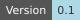
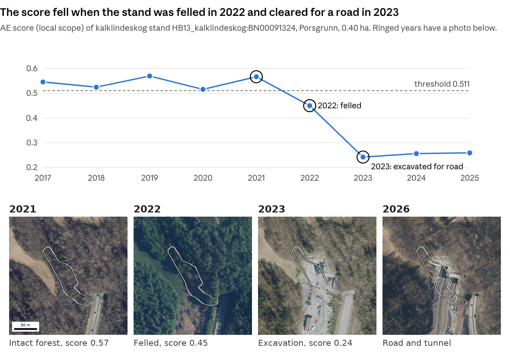
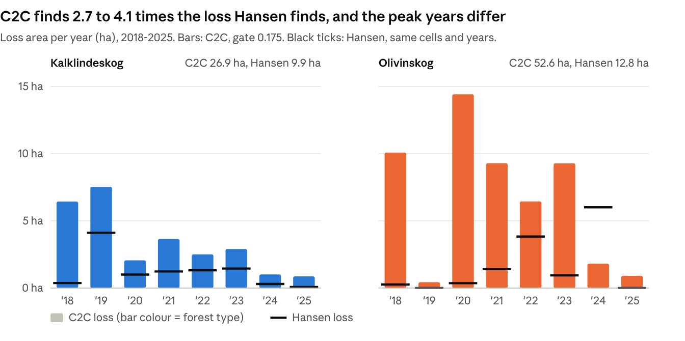

::: {.content-visible when-format="html"}
```{=html}
<div style="display:flex;gap:6px;flex-wrap:wrap"><a href="https://github.com/NINAnor/ecRxiv/wiki#status-badge" target="_blank" rel="noopener noreferrer"></a><a href="https://github.com/NINAnor/ecRxiv/wiki#naming-convention" target="_blank" rel="noopener noreferrer"></a><a href="https://github.com/NINAnor/ecRxiv/wiki#data-availability" target="_blank" rel="noopener noreferrer"></a><a href="https://github.com/NINAnor/ecRxiv/wiki#code-reproducibility" target="_blank" rel="noopener noreferrer"></a><a href="https://github.com/NINAnor/ecRxiv/wiki#open-science-badges" target="_blank" rel="noopener noreferrer"></a><a href="https://www.gnu.org/licenses/gpl-3.0" target="_blank" rel="noopener noreferrer"></a></div>
```
:::

> **Recommended citation**: Singh, G., Gray, A. M. and Mienna, I. M. 2026. Remote sensed monitoring of olivinskog and kalklindeskog, 2017-2025. Version 0.1. Norwegian Institute for Nature Research (NINA).

::: {.callout-tip collapse="true"}
## Metadata

| Variable | Value |
|:---|:---|
| Indicator ID | NO_FSAT_001; NO_FSAT_002 |
| Indicator Name | Forest condition score and trajectory from satellite embeddings; Annual forest loss from Sentinel-2 |
| verbatimName | Skogtilstand fra satellittinnbygginger; Årlig skogtap fra Sentinel-2 |
| Continent | Europe |
| Country | Norway |
| Ecosystem Condition Typology Class | B2 Structural state characteristics; C1 Landscape and Seascape Characteristics |
| Realm | Terrestrial (T) |
| Biome | T2 Temperate-boreal forests and woodlands biome |
| Ecosystem | T2.2 Deciduous temperate forests; T2.1 Boreal/montane forests |
| verbatimEcosystem | Kalklindeskog; Olivinskog |
| Year added | 2026 |
| Last update | 2026 |
| Version | 0.1 |
| Version comment | First release (11 Nov. 2026). |
| Normalised | Yes; No |
| Spatial aggregation pathway | Scale (10 m cell-year, AE score between a good and a poor reference pool) - Aggregate (stand median of the cell scores) - Classify (stand interval against threshold); Classify (10 m cell-year, C2C break with an NBR drop of 0.175 or more) - Aggregate (stand and forest-type loss area) |
| Precision | 95% interval around each stand score, from 2,000 resamples of whole reference stands (good pool) and whole 500 m areas (poor pool), with every cell of the stand rescored under each resample (inferential); Recall, precision and F1 against 1,577 labelled cells (41 loss, 19 degradation, 1,517 no change), with 95% intervals |
:::

::: {.callout-tip collapse="true"}
## Log

- 11 Nov. 2026 - v0.1: first release
:::

# Sammendrag {.unnumbered}

*Utkast, må kontrolleres av en norsktalende.*

Olivinskog og kalklindeskog er truede skogtyper og utvalgte naturtyper. Rapporten viser at tilstanden til alle kartlagte lokaliteter kan følges hvert år. Den bruker årlige satellittdata til å følge tilstand og skogtap i 737 feltkartlagte lokaliteter (589 kalklindeskog, 148 olivinskog) fra 2017 til 2025. Tilstanden beregnes fra AlphaEarth Foundations-satellittembeddinger [@brown2025, et årlig sammendrag av flere satellittsignaler for hver 10 m-celle], kalibrert mot feltkartlegging. Utviklingen i tilstand analyseres over tid for å utforske endringer i skogtypene. Skogtap vurderes med endringsanalyse av Sentinel-2 (C2C). For å oppdage brå endringer kjører en varslingstjeneste i nær sanntid, basert på stokastisk kontinuerlig endringsdeteksjon [S-CCD, @ye2021], for begge skogtypene. Dette fungerer selv om begge skogtypene bare finnes som små og spredte lokaliteter (medianlokaliteten av kalklindeskog er 0,38 ha, om lag 40 satellittceller på 10 × 10 m, og 80 % er mindre enn 1 ha), som er krevende å overvåke.

- **Samsvar med feltkartlegging:** Tilstandsskåren fra satellitt stemmer godt med feltkartleggingen. Den skiller lokaliteter i god og dårlig tilstand med AUC (arealet under ROC-kurven; 0,5 er tilfeldig og 1 er perfekt) 0,84 (kalklindeskog 0,86, olivinskog 0,77). Det betyr at en lokalitet i god tilstand i gjennomsnitt får høyere skår enn en i dårlig tilstand 84 av 100 ganger.
- **Tilstand 2025:** 52 % av kalklindeskoglokalitetene er i god tilstand og 21 % i dårlig tilstand; resten klassifiseres som ikke-skillbare fra terskelen. For olivinskog rangerer skåren lokalitetene pålitelig. Andelene for 2025 (8 % god, 51 % dårlig) er lavere enn i andre år, så de bør tolkes med forsiktighet når de vurderes alene. Selv for uforstyrret olivinskog varierer skårene fra år til år. Dette skyldes trolig små forskjeller mellom de årlige satellittembeddingene, ikke reelle endringer i skogen, og olivinskog påvirkes mer fordi det er åpen skog med en liten referansepool.
- **Utvikling 2017–2025:** De fleste lokalitetene (582 av 737) er stabile. Metoden fant 25 lokaliteter som har en nedadgående trend i tilstand. Én av dem er en kalklindeskog i Porsgrunn som ble til vei, og metoden detekterte dette fra satellittdata alene.
- **Skogtap:** Endringsanalyse med Sentinel-2 [Composite2Change, C2C, @hermosilla2015] viser tap av tresjikt på 26,9 ha i kalklindeskog (7,0 % av kartlagt areal) og 52,6 ha i olivinskog (4,0 %) i 2018–2025.
- **Endringskandidater i nær sanntid:** En automatisk tjeneste sjekker hvert nytt Sentinel-2-bilde for brå spektrale endringer og foreslår endringskandidater for kontroll. Tjenesten er i sin første sesong, og justering i 2027 vil øke andelen reelle tap som fanges opp.
- **Fremmede arter:** Lokaliteter der feltkartleggingen har registrert fremmede arter, har lavere tilstandsskår enn lokaliteter uten, i begge skogtypene. I kalklindeskog er medianskåren 0,53 med fremmede arter og 0,55 uten (131 og 178 lokaliteter). I olivinskog er den 0,44 med og 0,49 uten (12 og 87 lokaliteter). Begge forskjellene er statistisk signifikante (Mann-Whitney U-test: p \< 0,001 i kalklindeskog og p = 0,02 i olivinskog; en t-test gir samme resultat). Sammenhengen er en samvariasjon, ikke en påvist årsak (se 3.8).
- **Feltkontroll:** Vi peker ut 38 prioriterte lokaliteter for feltkontroll og mulige oppfølgende tiltak.

**Bruk av resultatene.** Det finnes et årlig og enhetlig bilde av alle kartlagte lokaliteter av olivinskog og kalklindeskog. Resultatene er mest pålitelige til to formål: samlede tall for hver skogtype (for eksempel areal med skogtap) og rangering av lokaliteter mot hverandre (hvilke lokaliteter som har høyere eller lavere skår). Lokaliteter kan sammenlignes etter utviklingen over flere år, ikke etter verdien i ett år. Metoden kan gjentas hvert år til lav kostnad for løpende overvåking av skogtilstand. Flere og mer finskalerte feltdata og årlige oppdateringer vil gjøre resultatene mer presise.

# Summary {.unnumbered}

Olivinskog and kalklindeskog are threatened forest types. This report shows that the forest condition of every mapped stand can be estimated every year. Annual satellite data is used to follow the forest condition and the forest loss of all 737 field-mapped stands (589 kalklindeskog, 148 olivinskog) from 2017 to 2025. Condition comes from AlphaEarth Foundations satellite embeddings [@brown2025, a yearly summary of multiple satellite signals of each 10 m cell], calibrated against field surveys. Forest condition trajectories are analysed through time to explore changes to the different forest types. Forest loss is assessed using Sentinel-2 change detection (C2C). To detect abrupt changes, a near-real-time alert service based on stochastic continuous change detection [S-CCD, @ye2021] runs for both forest types.

- **Agreement with field surveys:** the satellite-based condition score agrees well with the field surveys. It separates stands in good and in poor condition with an AUC (area under the ROC curve; 0.5 is chance and 1 is perfect) of 0.84 (kalklindeskog 0.86, olivinskog 0.77). This means that a stand in good condition correctly ranks higher than a stand in poor condition, on average, 84 times in 100.
- **Forest condition in 2025:** 52 % of kalklindeskog stands are in good condition and 21 % are poor; the remaining stands are classified as indistinguishable. For olivinskog, the score ranks the stands reliably. The 2025 shares (8 % good, 51 % poor) are lower than in other years, so read them with caution when considered independently. Even for undisturbed olivinskog sites, the scores vary from year to year. This may be caused by small differences between the yearly satellite embeddings reflective of weather changes, not by permanent change in the forest, and olivinskog is more affected because it is open forest with a small reference pool.
- **Condition trajectory 2017-2025:** most stands (582 of 737) are stable. The method identified 25 declining stands. One of them is a kalklindeskog stand in Porsgrunn that became a road, which the method found from satellite data alone.
- **Forest loss:** Sentinel-2 change detection [Composite2Change, C2C, @hermosilla2015] maps 26.9 ha of tree-cover loss in kalklindeskog (7.0 % of the mapped area) and 52.6 ha in olivinskog (4.0 %) between 2018 and 2025.
- **Near-real-time abrupt change detection:** an automatic service now checks each new Sentinel-2 image for abrupt spectral changes and suggests change candidates for review. The service is in its first season, and tuning in 2027 will increase the share of real losses that it catches.
- **Alien species:** stands where the field surveys recorded alien species have lower field and modelled condition scores than stands without them, in both forest types. In kalklindeskog, the median score is 0.53 with alien species and 0.55 without (131 and 178 stands, respectively). In olivinskog, it is 0.44 with and 0.49 without (12 and 87 stands, respectively). Both differences are statistically significant (Mann-Whitney U test: p \< 0.001 in kalklindeskog and p = 0.02 in olivinskog; a t-test agrees).
- **Field checks:** we suggest 38 priority stands for field checks and potential follow-up interventions.

**How to use the results.** There is an annual and consistently derived estimate of forest condition and forest loss of every mapped olivinskog and kalklindeskog stand. The results are most reliable for two uses: overall figures for each forest type (for example the area of forest loss), and ranking stands against each other (which stands score higher or lower). Stands can be compared by their trend over several years, not by the value of one year. The method can be repeated each year at low cost for ongoing monitoring of forest condition. More finer scale field labels and annual updates will make the results more precise.

# Introduction {#sec-introduction}

Olivinskog and kalklindeskog are two rare forest types in Norway. Olivinskog is pine (*Pinus sylvestris*) forest on olivine and serpentine rock, mainly in Sunnmøre. Kalklindeskog is linden (*Tilia cordata*) forest on calcareous ground, almost only around the Oslofjord. Both forest types were classified as endangered (EN) in the Norwegian Red List of Nature Types 2018, with kalklindeskog assessed as part of the broader kalkedellauvskog (broadleaved deciduous forest on calcareous ground) category [@artsdatabanken2018].

Both forest types are designated as selected nature types under the Norwegian Nature Diversity Act. Dedicated action plans have been established for kalklindeskog [@dn2011] and olivinskog [@miljodirektoratet2025], with the latter covering the period 2025–2037. The plans name some overlapping main threats: loss of area to development, mineral extraction and forestry, and the planting and spread of spruce. The olivinskog plan states that there is no established monitoring of the nature type.

Three field surveys mapped the stands: Miljødirektoratet's nature-type mapping (hereafter MI), Nature in Norway (NiN) mapping at 1:5000, and the older DN-håndbok 13 mapping (HB13). A survey visits a stand once and gives one field-assigned condition (*tilstand*) for one date.

Satellite data can map every mapped forest stand every year with the same method. This is especially useful for monitoring forest stands that are widely distributed and very costly to monitor in the field on a regular basis. Rare nature types with limited remaining area are among the hardest to monitor from satellites, and among the most useful to monitor. They are hard for three reasons. First, many stands are only a few satellite cells across, so their edge cells may mix forest with roads, fields and buildings. Second, many global forest-loss maps use 30 m cells. Third, there are few field-surveyed reference stands, and good forest of the same type looks different in different regions. Recent progress in geospatial AI has provided embedding datasets, such as AlphaEarth embeddings, that capture a cell's unique environmental, terrain, climatic, spectral and species-composition fingerprint, combining multi-sensor data over a year. However, they have not yet been tested for ecological condition assessment. This report addresses these challenges by constructing a model of forest condition, calibrated with field-assigned condition labels to derive satellite-based estimates of condition at 10 m resolution, which can be applied to each stand on an annual basis. This allows us to monitor losses and degradation across all recorded kalklindeskog and olivinskog stands.

This report uses annual satellite data to answer four questions:

1. How well does the satellite condition score agree with the field surveys, and what is the condition of the mapped stands in 2025?
2. How did the condition of the stands change between 2017 and 2025?
3. How much tree cover was lost after 2017, and where?
4. Are estimated satellite-based condition sensitive to the occurrence of alien species?

This report from satellite monitoring of these two forest types provides results per 10 m cell, per stand and per forest type. The discussion suggests which stands could be prioritised for field inspection. All stands are shown in the overview map (@sec-overview-map-and-data-viewer) and in the data viewer.

# Data and methods {#sec-data-and-methods}

This section gives only the information that is necessary to read the results. The [methods appendix]() gives the full methods and their tests. It is cited below as "Methods section *n*".

**Data sources.** The datasets used in this report, what each provides, their spatial resolution properties and their temporal coverage and what each dataset is used for (@tbl-1).

: Datasets used in this report, with what each provides, its cell size, the years used and what it is used for in the analysis. {#tbl-1}

| Dataset | What it provides | Cell size | Years used | Used for |
| :--- | :--- | :--- | :--- | :--- |
| AlphaEarth Foundations embeddings [@brown2025] | 64 numbers per cell that summarise the yearly satellite signal | 10 m | 2017-2025 | Condition score (AE score), trajectories |
| Sentinel-2 (Copernicus) | Optical images; yearly NBR composites and every new clear scene | 10 m | 2017-2026 | Forest loss (C2C), near-real-time candidates (S-CCD) |
| Hansen Global Forest Change [@hansen2013] | Year of tree-cover loss | 30 m | 2018-2025 | Independent loss check; removing cleared cells from the good pool; undisturbed ground for cut-offs |
| ESA WorldCover [@zanaga2022] | Land-cover classes | 10 m | 2021 | Poor reference pool (cropland, built-up) |
| Field surveys (MI, NiN 1:5000, HB13) | Stand outlines and field-assigned condition | Stand | Survey years | Stand map; good reference pool; calibration and tests |
| Forest loss labelled cells (this project) | Loss, degradation or no change, determined by manual inspection | 10 m | 2018-2025 | Tuning and testing the loss layers |
| RADD-Europe, OPERA DIST-ALERT, GFW DIST-ALERT | Disturbance alerts | 10-30 m | Varies by layer | Cross-checks for the C2C loss map |

**Stands and field data.** 737 mapped polygons: 589 kalklindeskog and 148 olivinskog (384 and 1,310 ha; areas use the union of overlapping polygons). Field-assigned condition is recorded for 440 stands: "god" (good) 263, "moderat" (moderate) 141, "dårlig" (poor) 20, "svært redusert" (severely reduced) 16. Due to few stands with a poor and severely reduced score, we have added the severely reduced stands to the poor category. The tests use the stands with a score in their survey year (250 good, 36 poor).

**Condition score (AE score).** AlphaEarth Foundations [@brown2025] gives an embedding for each 10 × 10 m cell in each year from 2017 to 2025: 64 numbers that summarise the yearly satellite signal. The method compares each cell with good and with poor reference cells. The AE score is the mean distance to the 25 nearest poor cells, divided by the sum of the mean distances to the 25 nearest good cells and the 25 nearest poor cells. It is near 1 when the cell is similar to the good cells and near 0 when it is similar to the poor cells. 168,829 cells have a score ([Methods appendix, Section 2](#section-2)). The score of a stand is the median AE score of its cells.

**Reference pools.** To be able to estimate forest ecological condition scores for a cell, we compare this test cell to two reference pools. The good reference pool represents untransformed forest that was assessed in the field to have close to expected forest conditions. A bad reference pool contains cells with a transformed state such as croplands and artificial areas. The "good" pool is the cells in stands that a field survey called good, of the same forest type. The local scope uses good stands near the scored stand: within 20 km for olivinskog, and the nearest 32 stands for kalklindeskog. Cells within 3 km of the scored stand are not used, so that a stand is not compared with itself or its close neighbours. These may share the same land cover conversion and would make the score look better than it is. The condition scores and classes in this report use this local scope, so each stand is compared with good forest of its own type nearby. This matters because good forest of the same type looks different in different regions (climate, bedrock, terrain). The local scope separates good from poor field stands better than the nature type scope that considers all stands within the nature type in Norway (AUC 0.84 against 0.78). Some stands have too few good stands nearby and so have no local score. For these 44 stands (12 kalklindeskog, 32 olivinskog), the condition score and class come from the nature type scope. Of the 263 good stands, 244 can be used as references: 13 were surveyed outside 2017-2025, the years with embeddings, and 6 have too few cells that all surveys call good. Before the good pool is used, the method removes the cells that Hansen Global Forest Change [@hansen2013] shows as cleared in or before the survey year of their stand. In this run, it removed 1,072 of the 85,009 good-pool cells (1.3 %), from 35 of the 244 reference stands. The "poor" pool is cells of cropland and built-up land in the ESA WorldCover land-cover map [@zanaga2022], sampled in a buffer 3-8 km around the stands and pooled for each forest type.

**Threshold and condition classes.** One threshold (0.511) separates good from poor condition, for cells and for stands, in both forest types. It is the value that best separates the 238 good and 35 poor stands that have a local score in their survey year [Youden's J: the share of good stands above plus the share of poor stands below is largest, @youden1950]. Moderate stands are not used in the fit. A stand is good when its whole 95 % interval is above the threshold, poor when its whole interval is below it, and indistinguishable when the interval includes the threshold. The interval comes from resampling whole reference stands (good pool) and whole 500 m areas (poor pool), so cells from one place do not count as independent. In each resample, every cell of the stand is scored again, and the stand value is the median of its cells.

**Trajectories.** Each year, the method takes the AE score of the stand (the median of its cells) at the nature type scope. It puts the values of each forest type on a common scale (z-score) and fits a trend line that single extreme years cannot skew [Theil-Sen slope, @sen1968] for 2017-2025. A positive slope means the stand becomes more like good forest of its type. The cut-offs for declining and improving are the steepest 2 % of slopes, in each direction, on ground that Hansen never shows as cleared. A stand with no trend but large swings between years is fluctuating: its standard deviation on the common scale is 0.50 or more, a cut-off chosen so that 19 % of undisturbed stands are classed as fluctuating. The other stands are stable. The nature type scope is used so that stands with too few good stand references nearby still get a trajectory ([Methods appendix, Section 5](#section-5)).

**Forest loss (C2C).** C2C [Composite2Change, @hermosilla2015] fits straight segments to the yearly Sentinel-2 normalised burn ratio [NBR, @keybenson2006] of each 10 m cell. NBR is an index that falls when the canopy is opened or removed. It gives the year and the size of the largest drop. C2C dates a loss to the first yearly composite after the change, so the loss years are 2018-2025. A drop counts as loss only when NBR falls by 0.175 or more. This cut-off was tuned on labelled cells. Hansen loss is an independent check. RADD-Europe [RAdar for Detecting Deforestation, from Sentinel-1, @vanderwoude2026], OPERA DIST-ALERT [@opera2024] and the Global Forest Watch DIST-ALERT layer are cross-checks for the C2C loss map. All these layers record canopy loss of any cause.

**Labelled cells.** We manually labelled 1,577 cells by looking at their Sentinel-2 time series and high resolution Google Earth and ESRI Wayback time series imagery: 41 loss, 19 degradation and 1,517 no change. Separate subsets were used to set the cut-offs and to evaluate the methods ([Methods appendix, Section 7](#section-7)).

**Near-real-time change candidates (S-CCD).** An automatic service on the Earth Observation Processing Framework (EOPF) reads every new clear Sentinel-2 scene over the forests. It updates the change model of each cell with stochastic continuous change detection [S-CCD, @ye2021]. It writes a table of change candidates, with break date, magnitude, loss or gain, confidence tier and status. The confidence tier (low, medium or high) rises with the number of clear observations that confirm the break and with the size of the drop. Breaks outside the growing season (November to February) are held at a lower tier. Each change candidate should be reviewed before considering it forest loss.

**Alien species.** The field surveys record spruce cover (variable 1AE-MB-D-PIab) and a flag for alien species (7FA). These were used to test whether the AE score is sensitive to alien species.

# Results {#sec-results}

## Overview {#sec-overview}

@fig-1 shows where the stands are and their condition class in 2025. @tbl-2 summarises the results for each forest type.

{#fig-1 width=100%}

: Summary results for all mapped stands, per forest type: number, area and scored cells; condition class in 2025 (local scope, 44 stands nature type scope); trajectory class 2017-2025; forest loss 2018-2025 from C2C and Hansen; and new S-CCD loss candidates. Stands use the union of overlapping polygons. {#tbl-2}

| Theme | Result | Kalklindeskog | Olivinskog |
| :--- | :--- | ---: | ---: |
| Stands | Mapped polygons | 589 | 148 |
|  | Mapped area (ha, union) | 384 | 1,310 |
|  | Scored 10 m cells | 38,327 | 130,502 |
| Condition 2025 (stands) | Good | 307 | 12 |
|  | Indistinguishable from threshold | 157 | 61 |
|  | Poor | 125 | 75 |
|  | Of these, classed with the nature type scope | 12 | 32 |
| Trajectory 2017-2025 | Stable | 485 | 97 |
|  | Fluctuating | 73 | 42 |
|  | Declining | 20 | 5 |
|  | Improving | 11 | 4 |
| Forest loss 2018-2025 (C2C) | Area (ha) | 26.9 | 52.6 |
|  | Share of mapped area | 7.0 % | 4.0 % |
| Forest loss 2018-2025 (Hansen) | Area (ha) | 9.9 | 12.8 |
| NRT change candidates (S-CCD) | New loss candidates | 198 | 2,694 |

*Note to @tbl-2:* S-CCD windows: kalklindeskog 20 Aug - 10 Oct 2026; olivinskog 22-29 Oct 2026. 2,541 of the 2694 olivinskog candidates are low tier, mostly breaks dated January 2026 (likely snow), so the counts are not comparable with kalklindeskog.

## Model performance {#sec-model-performance}

We tested the AE score against the field survey of each stand in its survey year, in a cross-validation design ([Methods appendix, Section 3](#section-3)). The main results are:

- **Order of the field-assigned condition classes:** the median AE score, before classifying the score as good, poor or indistinguishable, falls in the same order as field-assigned condition: good 0.56, moderate 0.52, poor 0.48 and severely reduce 0.43, for both types together (@fig-2 shows each type).
- **Good against poor stands:** the score separates good from poor stands with an AUC of 0.84 (95 % interval 0.74-0.91). For kalklindeskog the AUC is 0.86 (0.55-0.94), and for olivinskog 0.77 (0.63-0.88). The kalklindeskog value is uncertain because its 24 poor stands lie in only a few localities.
- **Threshold:** at 0.511, 74 % of good stands are above the threshold and 83 % of poor stands are below it. The indistinguishable class then identifies the stands with AE condition scores and uncertainty intervals that overlap the threshold (@tbl-3).
- **Effect of stand size:** small stands are more often (AE score) poor. We controlled for locality and size by comparing good and poor stands only within the same 5 km area and the same size class (smallest, middle or largest third). There, the score puts 73 of 100 pairs in the correct order, and stand size alone puts 63.
- **Clear cut ground:** cells that Hansen shows as cleared in 2018-2024 have steeper downward trajectories than cells in never-clear cut stands (AUC 0.73). 33 % of them are assigned a declining class, against 2 % of the others. The poor pool does not use Hansen data, so for that pool this is an independent test.
- **Olivinskog in 2025:** 2025 makes olivinskog look worse than it is. Of the 50 olivinskog stands that a field survey called good and that have a local score, the score calls 26 poor in 2025, against 10 to 19 in each year from 2018 to 2024. These stands probably did not change. This is likely the effect of a dry year and a temporary decline as opposed to a permanent decline in forest condition.

{#fig-2 width=100%}

: Field-assigned condition (rows) against AE condition class in 2025 (columns), number of stands. 44 stands have too few good stands nearby to be assessed for a local score. Their class comes from the nature type scope (@sec-data-and-methods). {#tbl-3}

| Forest type | Field-assigned condition | Good | Indistinguishable | Poor |
| :--- | :--- | ---: | ---: | ---: |
| Kalklindeskog | good | 110 | 58 | 30 |
|  | moderate | 51 | 32 | 26 |
|  | poor | 3 | 4 | 9 |
|  | severely reduced | 0 | 3 | 5 |
|  | not assessed | 143 | 60 | 55 |
| Olivinskog | good | 6 | 29 | 30 |
|  | moderate | 2 | 11 | 19 |
|  | poor | 0 | 2 | 2 |
|  | severely reduced | 0 | 0 | 8 |
|  | not assessed | 4 | 19 | 16 |

The threshold rests on only 35 poor stands, and 12 of them are olivinskog. @sec-how-to-use-the-results says how to use the score.

## Condition in 2025 {#sec-condition-in-2025}

In 2025, 307 of the 589 kalklindeskog stands (52 %) are in good condition, 157 (27 %) are indistinguishable from the threshold and 125 (21 %) are poor (@tbl-2). For olivinskog, 12 of 148 stands (8 %) are good, 61 (41 %) are indistinguishable and 75 (51 %) are poor. These counts include the 44 stands that are scored with the nature type scope (@sec-data-and-methods). Because olivinskog scores are unusually low in 2025 (@sec-model-performance), these 2025 shares probably overstate poor condition.

**A stand is not in one condition.** The threshold (0.511) is the score that best separates field-surveyed good from poor stands (@sec-data-and-methods). A cell above the threshold looks more like good reference forest of its type; a cell below it looks more like cropland or built-up land. The AE score is calculated for each cell, so part of a stand can be good and part can be poor. In the median kalklindeskog stand, 15 % of the cells are below the good-poor threshold. In the median olivinskog stand, 62 % are below it. 169 kalklindeskog stands and 52 olivinskog stands have between 20 % and 80 % of their cells below the threshold. For these stands, the 10 m cell scores show where in the stand to look for poor condition forest. This stand heterogeneity is also one reason why the score and the field survey can disagree. A survey gives one field-assigned condition for the whole stand, while the score of a mixed stand combines its good and poor parts.

**Stands with no local score.** 44 stands (32 olivinskog, 12 kalklindeskog; median 0.77 ha) have too few good reference stands nearby (none for 33, one for 11) for a local score. For these stands, the class comes from the nature type scope, which compares them with all good stands of their type in Norway. In 2025, the nature type scope assigns 12 of them as a 'good' class, 19 indistinguishable and 13 poor. The nature type scope separates good and poor field stands less well than the local scope (AUC 0.78 against 0.84), so these 44 stand classes are less certain. @fig-1 marks them with a dark outline.

## Trajectories 2017-2025 {#sec-trajectories-2017-2025}

Most stands are stable: 485 of 589 kalklindeskog stands and 97 of 148 olivinskog stands (@tbl-2). 73 kalklindeskog stands and 42 olivinskog stands fluctuate without a trend. The cut-offs are set on both forest types together, and olivinskog scores vary more from year to year, so more olivinskog stands are assigned a 'fluctuating' class. 25 stands decline, against about 15 expected by chance. Declines are more common where forest was cleared: 13 of the 140 stands with Hansen loss decline (9 %), against 12 of the 597 stands without loss (2 %, that is within the range expected by chance). There is therefore no general decline across the forest types. Recorded declines appear to be linked to localised forest clearance. These stands have been highlighted, and require confirmation, either through field assessment or manual inspection of high resolution imagery.

**Why the trajectory is more reliable than the AE score from one year.** The trajectory of a stand uses all nine years (2017-2025), and thus one high or low year attributed to a wet or dry year has little effect on the trajectory's direction. Looking at the score of a single year, however, stands would appear to decline or improve because of changes in the weather or statistical noise and may therefore not represent permanent declines. This effect is captured across the stands from each forest type and shown in @fig-3. On ground where Hansen shows no clearing, the forest extent may not have changed. But the share of cells in the poor band changes from year to year: from 12 % to 30 % in kalklindeskog, and from 27 % to 53 % in olivinskog. These changes may partly come from small differences between the yearly satellite embeddings, not from permanent changes in the forest condition.

The trajectory prevents this in two ways. It fits one slope to all nine years, and its class cut-offs are set on undisturbed ground, so only about 2 % of unchanged stands are called declining. The olivinskog stands that a field survey assigned "god" show the benefit. In 2025, 50 of these 65 stands have a local score, and it calls 26 of them poor. But none of the 26 have a declining trend: 16 are stable, 9 fluctuate and 1 improves. Thus, the trajectory correctly shows that most of these stands did not change, and that 2025 was a low year for the scores.

**Decline is mostly in stands that are already poor.** Of the 25 declining stands, 18 are poor in 2025 and 1, a kalklindeskog stand, is good. Of the 15 improving stands, 4 are poor and 7 are good (@tbl-4).

**Example.** @fig-4 shows a declining kalklindeskog stand of 0.40 ha (43 cells) in Porsgrunn. Its score was between 0.52 and 0.57 from 2017 to 2021. The trees were felled in 2022, and the score fell to 0.45. In 2023 the ground was excavated for a road, and the score fell to 0.24. The score did not recover in 2024 or 2025. The aerial photos of 2026 show a road and tunnel entrances. Thus this decline is a permanent conversion, and the method found it from satellite data alone.

{#fig-3 width=100%}

{#fig-4 width=100%}

: Trajectory 2017-2025 (rows) against condition class in 2025 (columns), number of stands. 44 stands have too few good stands nearby for a local score. Their class comes from the nature type scope (@sec-data-and-methods). {#tbl-4}

| Forest type | Trajectory | Good | Indistinguishable | Poor |
| :--- | :--- | ---: | ---: | ---: |
| Kalklindeskog | declining | 1 | 5 | 14 |
|  | improving | 5 | 3 | 3 |
|  | fluctuating | 31 | 17 | 25 |
|  | stable | 270 | 132 | 83 |
| Olivinskog | declining | 0 | 1 | 4 |
|  | improving | 2 | 1 | 1 |
|  | fluctuating | 2 | 16 | 24 |
|  | stable | 8 | 43 | 46 |

::: {.callout-note collapse="true" icon="false"}
## Analysis code: trajectory classification

Inputs: stand trajectories [`condition/outputs/data/trajectory.parquet`](../condition/outputs/data/trajectory.parquet) (one row per mapped polygon; columns poly_id, forest_type, sen_slope, sd, trajectory, c_2017..c_2025 = yearly naturalness-axis z-scores) and class cut-offs [`condition/outputs/data/trajectory_gate.json`](../condition/outputs/data/trajectory_gate.json) (key "stand" = [declining_below, improving_above], set so that 2 % of undisturbed stands fall in each tail). Full module: [`condition/src/condition/trend.py`](../condition/src/condition/trend.py) (functions calibrate_slope_gate, classify_trend). The code below, run from the repository root, reproduces the published trajectory classes (@tbl-1) exactly.

```python
import json, numpy as np, pandas as pd

t = pd.read_parquet('condition/outputs/data/trajectory.parquet')
lo, hi = json.load(open('condition/outputs/data/trajectory_gate.json'))['stand']

# sen_slope is the Theil-Sen slope of the nine yearly values; sd < 0.30 separates stable from fluctuating
c = np.where(t.sen_slope > hi, 'improving',
    np.where(t.sen_slope < lo, 'declining',
    np.where(t.sd < 0.30, 'stable', 'fluctuating')))

assert (c == t.trajectory).all()
print(pd.crosstab(t.forest_type, c))
```
:::

## Forest loss 2018-2025 (C2C) {#sec-forest-loss-2018-2025-c2c}

C2C finds loss on 26.9 ha of kalklindeskog and 52.6 ha of olivinskog from 2018 to 2025 (@tbl-2, @fig-5). This is 7.0 % of the mapped kalklindeskog and 4.0 % of the mapped olivinskog. Loss occurs in 258 kalklindeskog stands and 86 olivinskog stands. In kalklindeskog, loss is highest in 2018 and 2019 (643 and 752 cells). In olivinskog, loss is highest in 2020 (1,441 cells) and 2018 (1,008 cells).

**Loss and stand trajectory.** Most loss is in stands with a stable trajectory (67 ha). Two large olivinskog stands (119 ha and 126 ha) have 13.7 ha and 12.7 ha of loss. This is 10-12 % of their area, so the stand trajectory does not change. Loss on a small part of a large stand is visible in the map of cells, not in the stand class.

**Comparison with Hansen forest loss data.** For the same years, Hansen shows 9.9 ha of loss in kalklindeskog (2.6 %) and 12.8 ha in olivinskog (1.0 %). C2C finds 2.7 times as much in kalklindeskog and 4.1 times as much in olivinskog. Half of the Hansen loss cells are also C2C loss cells. Only 28 % of the C2C loss cells in kalklindeskog and 9 % in olivinskog are also Hansen loss cells. The peak years also differ (@fig-5). For olivinskog in 2024, Hansen data shows 6.0 ha and C2C only 1.8 ha. C2C needs observations after a break to fit a new segment, so it probably has too little data after 2024 and 2025 to establish a loss breakpoint.

**Accuracy.** Against the 1,577 labelled cells, C2C finds 80 % of the loss cells, and 67 % of its loss calls are true loss (@tbl-5). Of its 16 false loss calls, 6 are labelled degradation. Hansen finds 55 % of the loss cells, and 52 % of its loss calls are true. C2C is better in kalklindeskog (F1 0.76; F1 combines the losses found and the false alarms, and 1 is perfect) than in olivinskog (F1 0.59), but olivinskog has only 8 labelled loss cells. Hansen finds 1 of these 8.

**Independent validation.** On the 1,215 independent cells that we labelled inside stands (part of the 1,577), C2C finds forest loss much better than the global Hansen forest-loss map (F1 score 0.82 against 0.58). About one in three C2C loss detections is not real loss, so the C2C loss areas are an upper estimate of loss where all trees are removed.

**Other layers.** C2C is the main loss map. Three other alert layers can be used beside it as supporting information. Where one agrees with C2C, the loss is more certain. Where one flags a spot that C2C does not, this flags an area for further investigation. OPERA DIST-ALERT (2023-present) flags any drop in vegetation cover, not only clearing. 24 % of the C2C loss cells in these years have an OPERA alert within 21 m, and most OPERA alerts are in olivinskog (1,048 of 1,243). RADD-Europe uses radar (Sentinel-1), which sees through most cloud. It confirms 86-93 cells (about 0.9 ha) a year in kalklindeskog in 2021-2023 and 142 cells (1.4 ha) in olivinskog in 2022. The GFW DIST-ALERT layer adds 42 alerts in the stands, from 2025 only.

{#fig-5 width=100%}

: Accuracy for loss against labelled cells (41 loss, 19 degradation, 1,517 no change). 95 % intervals in brackets. {#tbl-5}

| Detector | Cells | Loss found (recall) | Loss calls that are true (precision) | F1 | False alarms on no-change cells |
| :--- | ---: | ---: | ---: | ---: | ---: |
| C2C, cut-off 0.175 | 1,577 | 0.80 (0.65-0.90) | 0.67 (0.53-0.78) | 0.73 | 1.0 % |
| Hansen 2018-2025 | 1,577 | 0.55 (0.40-0.69) | 0.52 (0.38-0.67) | 0.54 | 1.3 % |

::: {.callout-note collapse="true" icon="false"}
## Analysis code: loss detection

Inputs: [`data/c2c_pixels.geojson`](../data/c2c_pixels.geojson) (one point per 10 m cell per stand; properties forest_type, pix_id, change_year, magnitude). Full pipeline: the C2C export scripts in [`scripts/`](../scripts/). The code below, run from the repository root, reproduces the loss areas in @tbl-1 and @fig-5.

```python
import geopandas as gpd, numpy as np

# Overlapping polygons share cells, so each cell counts once per forest type
g = gpd.read_file('data/c2c_pixels.geojson').drop_duplicates(['forest_type', 'pix_id'])

# The cut-off 0.175 is the NBR drop tuned on labelled cells
loss = g[g.magnitude <= -0.175]
print(loss.groupby('forest_type').size() * 0.01)   # ha: one cell = 0.01 ha

# Change year is stamped at the end of the year before the loss (change_year X.996 = loss in year X+1)
year = np.floor(loss.change_year).astype(int) + 1
print((loss.groupby(['forest_type', year]).size() * 0.01).unstack(0))
```
:::

## Near-real-time change candidates (S-CCD) {#sec-near-real-time-change-candidates-s-ccd}

The near-real-time service flags possible abrupt change within weeks of each new Sentinel-2 image, so that it can be reviewed by a human. For each candidate abrupt change, a human should verify each one before it is reported as forest loss, because breaks also come from thinning, storms or wet ground. We test how many real losses reach the list, and how long the list is. A list that is too long because it contains too many false alerts may require a lot of time and resources to verify and is therefore not preferred.

**What the user gets.** The service writes one locality for each alert. Each entry is one cell, with the break date, magnitude, loss or gain, confidence tier, status and date of detection.

**New candidates.** The service marked 198 loss candidates as new: 108 high, 86 medium and 4 low confidence. The first run gave 192 of them, because it found older breaks: 82 of them have the break date 21 April 2026. The later runs gave only 6 new candidates in seven weeks: 4 in the week of 24 August and 2 in the week of 5 October. For these 6 candidates, the median time from the break date to the candidate was 23 days (19 to 55 days). The service waits for more clear scenes to confirm a break. Six candidates are too few to give a reliable delay. At this rate, the review load is less than one candidate a week.

**History.** The first run also processed 2017-2026. It gives 4,898 historical loss candidates (1,564 high, 1,517 medium and 1,817 low) on 4,572 cells (46 ha, 12 % of the mapped kalklindeskog). Another 63,600 breaks are below the cut-off, and most of them are gains (53,538).

**Real losses on the list.** We tested all historical and new candidates against the labelled cells (@tbl-6). There are 32 labelled loss cells in kalklindeskog. The candidate list contains 8 of them (25 %), and the high tier alone contains 4 (13 %). C2C contains 27 of the same 32 (84 %). When we also count the breaks below the cut-off, the list contains 20 of the 32 (63 %). But it then also contains 37 % of the labelled no-change cells. Thus the cut-off removes many real losses.

**Length of the list.** On labelled cells, 11 % of the high- and medium-tier candidates are real loss. Thus a reviewer rejects about 9 of 10 candidates. The low tier added no real losses and 61 rejections.

**Olivinskog.** The olivinskog service started on 22 October 2026. Up to 29 October it marked 2,694 loss candidates as new: 67 high, 86 medium and 2,541 low confidence. The first run gave 2,585 of them. Most have break dates in mid-January 2026 (2,152 between 17 and 27 January), when snow and low sun can look like a loss. The first run also gives 21,765 historical loss candidates on 19,178 cells (192 ha, 15 % of the mapped olivinskog). Olivinskog has only 9 labelled loss cells. The high tier contains 2 of them, all tiers 3, and with the breaks below the cut-off 6 (C2C: 5). Of the high- and medium-tier candidates on labelled cells, 6 % are real loss. These counts are too small for firm rates.

: S-CCD loss candidates (historical and new, 2017-2026) against 1,270 labelled kalklindeskog cells (32 loss) and 307 labelled olivinskog cells (9 loss). Unlike kalklindeskog, the olivinskog low tier adds 1 real loss, as well as 32 rejections. A longer list catches more real losses but gives the reviewer more false candidates. {#tbl-6}

| Candidate set | Loss cells on the list (recall) | Candidates that are real loss (precision) | No-change cells on the list |
| :--- | ---: | ---: | ---: |
| Kalklindeskog: High tier | 4 of 32 (13 %) | 13 % | 2.1 % |
| Kalklindeskog: High and medium tiers | 8 of 32 (25 %) | 11 % | 5.3 % |
| Kalklindeskog: All tiers | 8 of 32 (25 %) | 6 % | 10.3 % |
| Kalklindeskog: All breaks, also below the cut-off | 20 of 32 (63 %) | 4 % | 36.7 % |
| Olivinskog: High tier | 2 of 9 (22 %) | 14 % | 4 % |
| Olivinskog: High and medium tiers | 2 of 9 (22 %) | 6 % | 11 % |
| Olivinskog: All tiers | 3 of 9 (33 %) | 4 % | 21 % |
| Olivinskog: All breaks, also below the cut-off | 6 of 9 (67 %) | 4 % | 51 % |

## Small stands {#sec-small-stands}

Many kalklindeskog stands are small fragments next to roads and buildings. 358 of the 589 kalklindeskog stands (61 %) are smaller than 0.5 ha, with a median of 0.22 ha (about 22 cells). Small stands are more often poor: 27 % of small kalklindeskog stands are poor, against 13 % of larger stands. Of the 121 small kalklindeskog stands that a survey assigned "god", the score calls 27 poor. In a small stand, many cells include road, verge or building, and these mixed cells can lower the score.

For a stand smaller than about 0.5 ha, use the score as a reason for further investigation, not as a result.

## Alien-species records {#sec-alien-species-records}

Among the 408 stands where the field survey recorded the alien-species variable (7FA), stands with alien species have lower scores in both forest types (@tbl-7). This shows that alien species and lower scores occur together, not that alien species cause the lower scores. Stands near roads and buildings can have both more alien species and more disturbance. Part of the lower score may therefore come from the disturbance, not from the alien species themselves.

: Alien-species flag (7FA) against the 2025 condition score (local scope), within each forest type. Welch's t-test compares the means, and a Mann-Whitney U test compares the distributions; the Mann-Whitney test gives p \< 0.001 (kalklindeskog) and p = 0.02 (olivinskog), and Welch's t-test gives p \< 0.001 and p = 0.03. {#tbl-7}

| Forest type | 7FA flagged: stands, median score | Not flagged: stands, median score | Difference, p |
| :--- | ---: | ---: | ---: |
| Kalklindeskog | 131, 0.53 | 178, 0.55 | \< 0.001 |
| Olivinskog | 12, 0.44 | 87, 0.49 | 0.02 |

## Overview map and data viewer {#sec-overview-map-and-data-viewer}

@fig-1 shows all 737 stands coloured by condition class in 2025. The separate data viewer (the folder app/ of the project repository) shows the forest polygons and the S-CCD loss and gain alerts. Its area-cover series are placeholder data until the real series are connected.

::: {.content-visible when-format="html"}

:::

# Discussion {#sec-discussion}

## Main findings in relation to the action plans {#sec-main-findings-in-relation-to-the-action-plans}

The olivinskog action plan for 2025-2037 says that further loss of area must be strongly reduced to stop the decline of the nature type [@miljodirektoratet2025]. It also says that there is no established monitoring. The kalklindeskog plan names protection and management against overgrowth as measures, and spruce as a threat. Measured against these plans:

- **Loss of area continues in both types.** C2C finds loss on up to 7.0 % of the mapped kalklindeskog and 4.0 % of the mapped olivinskog in 2018-2025. This analysis shows where losses occur and updates the extent of each forest type. Kalklindeskog is the smaller type, so each hectare lost is a larger share of it. For olivinskog, these data give a baseline for the action plan's aim of strongly reducing area loss.
- **Few stands change in condition.** 25 stands decline and 15 improve. Most declining stands are already in poor condition (18 of 25), while improving stands are mostly good (7 of 15) or indistinguishable (4 of 15). The data do not show a clear national decline or improvement in condition for 2017-2025.
- **Some decline is permanent conversion to non-forest land use, such as roads, buildings or farmland.** Our example stand in @fig-4 became a road. Loss with no sign of regrowth for many years points to conversion. Full recovery of a forest takes decades, so this trajectory analysis asks whether vegetation starts to come back. On poor soils, even this first regrowth can take several years to show in satellite data after felling, so losses after 2021 cannot yet be told apart from conversion.
- **The score ranks olivinskog stands well, and more finer-scale field labels will sharpen its classes.** Olivinskog has 12 poor field labels and a small reference pool, and its yearly scores vary. More field labels and a mean over several years will give dependable class shares for this type.

We suggest 38 stands for field checks that can validate our findings and may lead to prioritised action, all marked in the overview map (@sec-overview-map-and-data-viewer): the 1 good stand that declines, the 18 poor stands that decline, and the 21 stands with 0.5 ha or more of C2C loss (two stands are in two groups). 18 of the 38 are kalklindeskog and 20 are olivinskog.

## Model limitations {#sec-model-limitations}

Five points affect the condition results:

- **Year effects.** On undisturbed stands, the yearly share of poor cells changes by 18 to 26 percentage points. This is of the same size as real change. The trajectory of each stand uses all nine years and is less sensitive to inter-annual temporary changes attributed by, for example, a dry year.
- **Few poor field labels.** The threshold rests on 35 poor stands in only five 5 km areas (three for kalklindeskog, two for olivinskog), and 12 of them are olivinskog. The intervals are therefore wide. More poor labels in new localities, and a poor reference pool expanded to similar forest types, may strengthen the condition assessment of olivinskog. Both will be explored in 2027.
- **Small stands.** 61 % of the kalklindeskog stands are smaller than 0.5 ha. Their cells may mix forest with roads and buildings. These mixed cells look less like the good reference forest, so the condition score of small stands may be underestimated, and some may be called poor when the forest itself is in good condition. We estimate that the score is less reliable for stands smaller than 0.5 ha: 27 of 121 small kalklindeskog stands that a survey called good (22 %) are scored poor. These stands need an extra check in the field or on aerial photos.
- **Interpretation.** Compare condition classes between stands of the same forest type, not between the two types. Year-to-year variation differs between the types (@sec-model-performance). A low year for olivinskog, such as 2025, can make it look worse than kalklindeskog even when neither has changed.
- **Area estimates**. Area is currently based on pixel counting estimates which is biased by estimation and classification errors. design-based area estimation accounts for these biases, but requires expert labelled point data. By obtaining finer scale field-assigned condition, these labels will also support unbiased area estimation with confidence intervals more suited to decision making.

Owing to mixed condition stands, the proportions of the condition classes in each forest type are more robust than the class of one stand. For a single stand, treat the class as a prompt to check the stand in the field or on aerial photos, not as a final assessment.

## Forest loss {#sec-forest-loss}

**C2C is the most useful loss layer for these stands.** It finds 80 % of the verified loss cells, and 2.7 to 4.1 times more loss than the global Hansen product [@hansen2013], and it has a 10 m cell that better suits small stands. The magnitude cut-off is necessary: without it, C2C finds a break in most cells.

**Hansen misses most loss in olivinskog** (1 of 8 labelled loss cells). Use Hansen as an independent check, not as the main loss layer. RADD-Europe and OPERA DIST-ALERT agree little with C2C at cell level. They cover a shorter period, and OPERA has a coarser cell (30 m).

**All layers record canopy loss of any cause.** The forest loss layers cannot separate felling from storm or dieback, or permanent conversion from forestry.

**S-CCD detects most real losses, and its cut-off is the step to tune.** S-CCD records a loss break in 63 % of the labelled loss cells and in 37 % of the labelled degradation cells (20 of 32 loss cells and 6 of 9 degradation cells in kalklindeskog; 6 of 9 loss and 1 of 10 degradation cells in olivinskog; 33 of 60 events in total). The service runs automatically after each new clear scene, so these breaks are available within weeks. The present cut-off is strict and keeps 13 of the 60 events on the candidate list. In 2027 we will tune the cut-off and the confidence tiers on the labels, so that the list keeps more of the detected changes at a review load that people can manage.

## Alien species {#sec-alien-species}

The alien-species flag correlates with lower AE scores in both forest types. This is the clearest species result. It shows that alien species and lower scores occur together, but not that one causes the other.

## How to use the results {#sec-how-to-use-the-results}

- **Rank and prioritise, then check.** The AE score is suited to ranking stands and choosing where to look first. For a decision about one stand, combine the score with a field visit or aerial photos.
- **Read trends, not single years.** Compare stands by their trajectory over several years, not by the value of one year. The 2025 olivinskog shares are from a low year and probably overstate poor condition (@sec-condition-in-2025).
- **Compare within one forest type.** Year-to-year variation differs between the types, so compare condition classes between stands of the same type, not between olivinskog and kalklindeskog (@sec-model-limitations).
- **Take extra care with small and mixed stands.** Scores of stands smaller than 0.5 ha are less reliable (@sec-small-stands). In mixed stands, the 10 m cell scores show where in the stand the poor cells are (@sec-condition-in-2025).
- **Treat loss figures as candidates and upper estimates.** S-CCD candidates must be reviewed before they are reported as forest loss (@sec-near-real-time-change-candidates-s-ccd), and C2C loss areas are an upper estimate (@sec-forest-loss-2018-2025-c2c).

# Development needs and next steps {#sec-development-needs-and-next-steps}

We propose these steps for 2027:

1. **Do field checks** of the 38 suggested stands (@sec-main-findings-in-relation-to-the-action-plans): Confirm whether the declines and losses are real (validation), to potentially add new fine-scale poor-condition labels, and to decide whether follow-up action is needed.
2. **Record finer-scale condition labels inside known stands.** During the field checks in step 1, record condition for small plots using a nested design (plots with dimensions of 90, 30, 10 m). Stands are not uniform, so each finer-scale plot label then matches the cells it describes.
3. **Correct the year effect** before the next annual update, for example with stable reference ground. Then report class counts as a mean of several years, not one year.
4. **Tune the S-CCD cut-off and confidence tiers** on the labels, so that the candidate list keeps more of the detected changes.
5. **Expand the poor reference pool** to similar forest types and to degraded forest, not only transformed land, and test whether this strengthens the condition assessment of olivinskog.
6. **End-user feedback:** users of the data report where the results work and where they fail, and add their own labels, to guide the next versions.

# Data and code availability {#sec-data-and-code-availability}

The project repository ([github.com/NINAnor/effektovervaking_forests](https://github.com/NINAnor/effektovervaking_forests)) holds all code. The folder src/effektovervaking_forests/condition/ calculates the condition score and the trajectories. The data viewer is in the folder app/. The folder src/effektovervaking_forests/ holds the S-CCD service. The file data/condition/outputs/condition_results.gpkg holds the results for all stands and cells. The S-CCD candidate table is s3://miljodata-test/156004_08_effektovervaking_2026_2030_opsjon_2_fjernmaling/sccd/operational/alerts/kalklindeskog_alerts.parquet. All input data are public: AlphaEarth Foundations embeddings, Sentinel-2 (Copernicus), Hansen Global Forest Change, ESA WorldCover.

# References {.unnumbered}

::: {#refs}
:::



# Appendix {.appendix .unnumbered}

## Methodology {.unnumbered}

The full methodology, including the equations, parameters, validation results and known limitations, is given in the methods appendix, which is updated together with the analysis: **[Methods: remote sensed monitoring of olivinskog and kalklindeskog, 2017-2025]()**.

## Author contributions {.unnumbered}

Conceptualisation, methodology, formal analysis, visualisation, writing (original draft): GS, AMG.

Data curation, validation, writing (review and editing): GS, AMG, IMM.

Field data: MI, NiN 1:5000 and HB13 field surveys; the MI surveys were commissioned by Miljødirektoratet.

## Software {.unnumbered}

::: {.callout-note collapse="true"}
## Python environment

- Python 3.12.14
- numpy 2.4.6
- pandas 3.0.3
- geopandas 1.1.3
- pyarrow 24.0.0
- scipy 1.17.1
- scikit-learn 1.8.0
- earthengine-api 1.7.28
- pyxccd 1.0.3
- rasterio 1.5.1
- shapely 2.1.2
- duckdb 1.5.3
- pillow 12.3.0
- Quarto 1.8.27
- pandoc 3.1.3
:::
